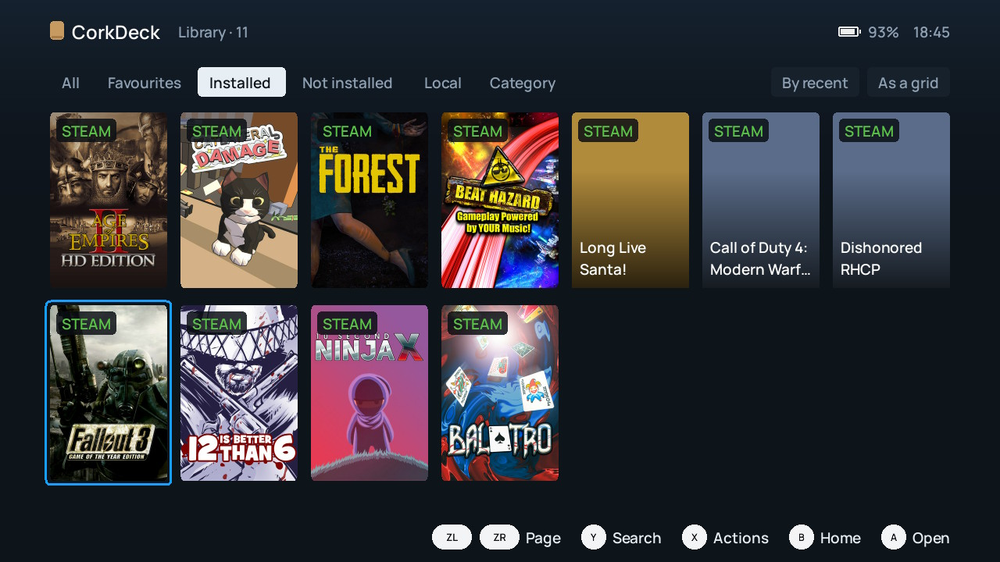
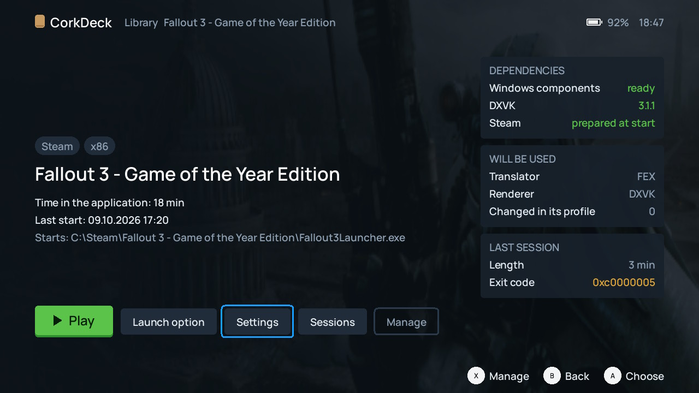
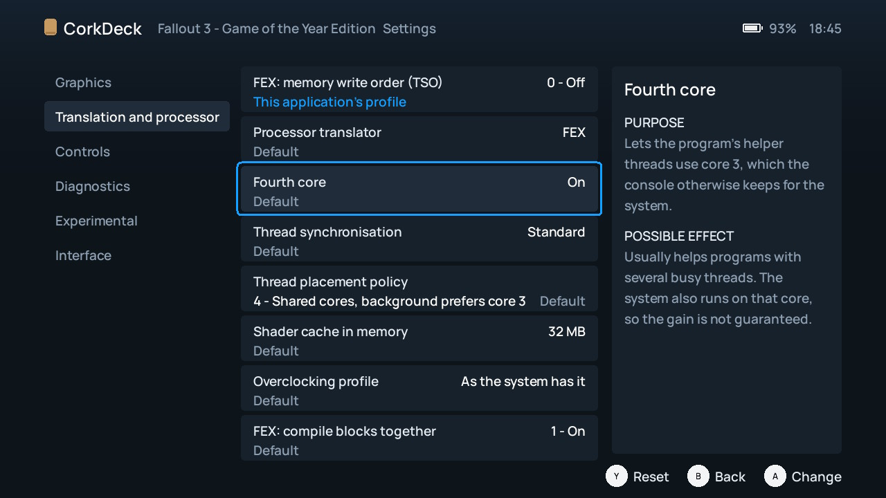
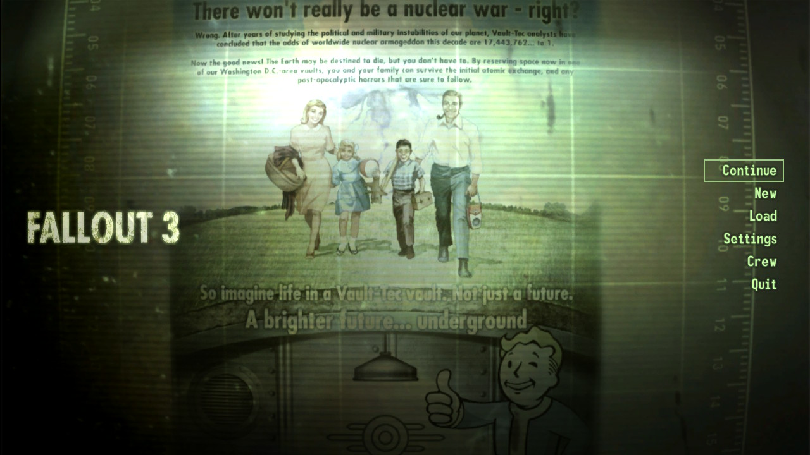

# CorkDeck

**Windows-игры и библиотека Steam на Nintendo Switch.**

[English](README.md) · [Скачать](https://github.com/plv890/CorkDeck/releases/latest) · [Установка](docs/INSTALL.ru.md) · [Совместимость](docs/COMPATIBILITY.md) · [Благодарности](CREDITS.md)

CorkDeck — homebrew-приложение, которое запускает Windows-игры и программы на Nintendo Switch прямо в родной системе консоли, Horizon OS. В одной оболочке, рассчитанной на геймпад, собраны библиотека игр, вход в Steam и загрузка игр, настройки для каждой игры и диагностика запусков. Идея оболочки — игровой режим Steam Deck.

Запуск обеспечивают [Wine](https://www.winehq.org), трансляторы x86-кода [FEX](https://github.com/FEX-Emu/FEX) и [Box64](https://github.com/ptitSeb/box64), графика — Mesa, [DXVK](https://github.com/doitsujin/dxvk) и [VKD3D-Proton](https://github.com/HansKristian-Work/vkd3d-proton).

> **CorkDeck — форк проекта [Autorun](https://github.com/autorunhq/autorun) (раньше назывался Wine-NX).**
> Всё, благодаря чему Windows-программы вообще работают на Switch, сделано автором и участниками этого проекта. CorkDeck строит поверх их работы другую оболочку и работу со Steam. Спасибо им.

CorkDeck — экспериментальный проект. Часть игр работает, многие пока нет, а скорость сильно зависит от игры. Прежде чем рассчитывать на конкретную игру, посмотрите, [что действительно проверено](docs/COMPATIBILITY.md).

## Снимки экрана

Снимки без обработки, сделаны с Nintendo Switch на CorkDeck 0.2. Интерфейс есть на русском и английском.

| | |
| --- | --- |
|  |  |
| Страница игры: с чем она запустится и чем закончился прошлый сеанс | Настройки игры: у каждого пункта написано, для чего он и на что может повлиять |

Fallout 3 (версия из Steam) в главном меню на Nintendo Switch, запущен из CorkDeck 0.2.

## Скачать и установить

1. Скачайте **`CorkDeck-0.3c.zip`** в разделе [Releases](https://github.com/plv890/CorkDeck/releases/latest). Архивы «Source code» там же — для разработчиков; для установки нужен именно ZIP с именем CorkDeck.
2. Распакуйте его и скопируйте папку `switch` в корень карты памяти.
3. Откройте Homebrew Menu через игру (держите **R** при её запуске), запустите `wine-nx-runtime` и пройдите первичную настройку: она поставит значок CorkDeck в меню HOME и скачает компоненты Windows.

Полная инструкция, включая переход с Autorun и обновление с прежней версии CorkDeck, — в [docs/INSTALL.ru.md](docs/INSTALL.ru.md).

### Что потребуется

- Nintendo Switch с Atmosphère и возможностью запускать homebrew. Только emuMMC.
- Карта памяти: около 60 МБ под CorkDeck, около 1 ГБ под компоненты Windows, плюс место под игры.
- Wi-Fi для первой настройки и для Steam.
- Ваши собственные игры. В комплект они не входят.
- По желанию: [Horizon OC](https://github.com/Horizon-OC/Horizon-OC), если вы разгоняете консоль. Сам CorkDeck частоты не меняет.

## Что добавлено по сравнению с Autorun

CorkDeck сохраняет от Autorun то, что исполняет Windows-код, и перестраивает приложение вокруг этого.

**Интерфейс**

- Новая оболочка: главная (недавние игры и список «Требует внимания», где названо, что именно не так), библиотека и страница у каждой игры.
- Вкладки библиотеки: все, избранное, установленные, не установленные, локальные; свои категории, сортировка, сетка или список, поиск.
- Страница игры ещё до запуска показывает, какие компоненты Windows, версия DXVK, транслятор и рендер будут использованы, сколько вы играли и чем закончился прошлый сеанс. Если у игры несколько программ, можно выбрать, какую запускать.
- Настройки, где **у каждого пункта написано, для чего он и на что может повлиять**, и видно, откуда взято значение: по умолчанию, из общих настроек или из профиля игры. Сброс — одной кнопкой.
- Главное меню на **−** и панель состояния на **+** с любого экрана; уведомления в углу, а не окна поверх всего.
- Экран запуска с обложкой игры держится, пока игра не нарисует первый кадр; окна лаунчеров и настроек видны до начала отрисовки.
- Русский и английский язык интерфейса, новый шрифт (Manrope).
- После выхода из игры вы возвращаетесь в оболочку.

**Steam**

- Вход прямо в оболочке, по QR-коду или паролю; сессия сохраняется между запусками.
- Игры вашего аккаунта — на вкладке «Не установленные», обложки подгружаются из Steam.
- Экран загрузок: ход, скорость за последние две минуты, оставшееся время.
- Загрузка продолжается после обрыва. Если продолжить нельзя, CorkDeck предлагает начать заново, отменить или попробовать ещё раз и записывает причину сбоя.
- Если у игры нет файлов на языке системы, ставится английский.
- Выполняются установочные сценарии Steam (записи реестра и копирование папок) — без них, например, Fallout 3 не запускается вовсе.
- Игры на Steamworks.NET больше не закрываются сразу после старта.

**Запуск игр**

- Кнопка «Играть» сама докачивает недостающие компоненты Windows.
- Перед запуском CorkDeck читает, какие библиотеки нужны программе, и называет недостающие. Microsoft Visual C++ 2015–2022 скачивается с сайта Microsoft и добавляется само.
- Локальная библиотека Steamworks внутри приложения: устроена так, как её вызывают игры, собранные Visual C++, со всеми семействами интерфейсов.
- Зарегистрированы декодеры картинок Windows (PNG, JPEG и другие): игры, которые грузят изображения через помощники Direct3D, их находят.
- CorkDeck не меняет частоты и напряжения консоли. Разгон остаётся в Horizon OC, где вы его задаёте.
- Игру можно удалить с карты памяти с её страницы; «Хранилище» показывает, сколько занимает каждая игра.
- Общий переключатель показа FPS и времени кадра.
- Если система закрывает приложению доступ к карте памяти, CorkDeck подключается заново без перезапуска.

**Диагностика**

- У каждого запуска своя папка отчёта: журнал игры, применённые настройки, загруженные модули, когда и чем всё закончилось.
- История сеансов по каждой игре: длительность и код завершения.
- Хранятся журналы двух предыдущих стартов.

**Убрано:** приложение больше не обновляет себя из сети. Новая версия ставится заменой одного файла.

CorkDeck не ставится поверх Autorun: оба используют папку `switch/wine`, поэтому на карте должен быть один из них. Точка ответвления описана в [FORK.md](FORK.md), изменения этой версии — в [docs/RELEASE-0.3.md](docs/RELEASE-0.3.md) (быстрые обновления — [0.3b](docs/RELEASE-0.3b.ru.md), [0.3c](docs/RELEASE-0.3c.ru.md); 0.2 — [RELEASE-0.2](docs/RELEASE-0.2.md)).

Если что-то сломано в CorkDeck, пишите [сюда](https://github.com/plv890/CorkDeck/issues), а не авторам Autorun: изменённые части писали не они.

## Частые вопросы

**Это SteamOS или Linux на Switch?**
Нет. CorkDeck не ставит другую операционную систему и не требует Linux или Android на консоли. Это homebrew-приложение для родной системы Switch. От Steam Deck взята только идея игрового режима.

**Это настоящий клиент Steam?**
Нет. В CorkDeck свой небольшой клиент Steam: он входит в аккаунт, показывает ваши игры и скачивает их. Друзей, достижений, облачных сохранений, оверлея и сетевой игры нет.

**Какие игры работают?**
Списка совместимости пока нет, есть только короткий перечень [записанных результатов](docs/COMPATIBILITY.md). Реалистичная цель — старые игры на Direct3D 9–11. В Switch стоит мобильный чип 2015 года, а код x86 идёт через транслятор, так что ожидания стоит соизмерять.

**Работает ли на любой Switch?**
Проект разрабатывался и проверялся на одной консоли. Отчёты с других моделей приветствуются.

**Это безопасно для консоли?**
CorkDeck работает под пользовательской прошивкой, чего Nintendo не разрешает. Держите его в emuMMC. Первичная настройка может поставить патчи загрузки, нужные части игр; перед этим шагом сохраните папки `atmosphere` и `bootloader` или пропустите его.

## Авторство и использование ИИ

Автор CorkDeck — **Maj0ra'sMask** (на GitHub [@plv890](https://github.com/plv890)): идея, продуктовые решения, системная инженерия и проверка на консоли.

**Код и документацию форка в основном писали ИИ-агенты** (OpenAI Codex / GPT и Anthropic Claude) под его руководством; результат проверялся автоматическими тестами на ПК и запусками на настоящей консоли. Это сказано прямо, чтобы каждый, кто читает или использует код, знал, как он появился. Относится это только к изменениям CorkDeck: у Autorun, Wine и остальных компонентов свои авторы.

## Обратная связь

Сообщения об ошибках и точные результаты по играм приветствуются, на русском или английском. Правила — в [CONTRIBUTING.md](CONTRIBUTING.md). Перед отправкой просматривайте журналы и никогда не выкладывайте `steam-session.vault`, пароли, токены и QR-коды входа.

## Лицензия и благодарности

Wine и изменения для Horizon распространяются по LGPL-2.1-or-later: [LICENSE](LICENSE), [COPYING.LIB](COPYING.LIB). У остальных компонентов свои лицензии: [NOTICES.md](NOTICES.md), [THIRD_PARTY_NOTICES.md](THIRD_PARTY_NOTICES.md) и папка `switch/wine/licenses` в пакете. Благодарности — в [CREDITS.md](CREDITS.md). Вступление исходного проекта сохранено в [README.upstream.md](README.upstream.md).

CorkDeck не связан с Nintendo, Valve, Microsoft и проектом Autorun и не одобрен ими. Nintendo Switch, Steam, Steam Deck, SteamOS и Windows — товарные знаки их владельцев.
